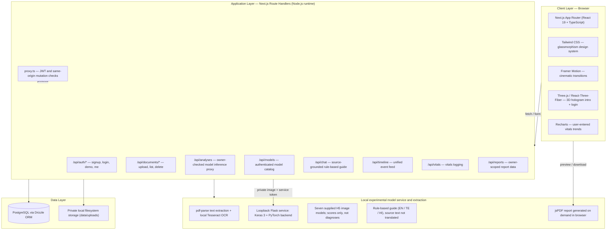
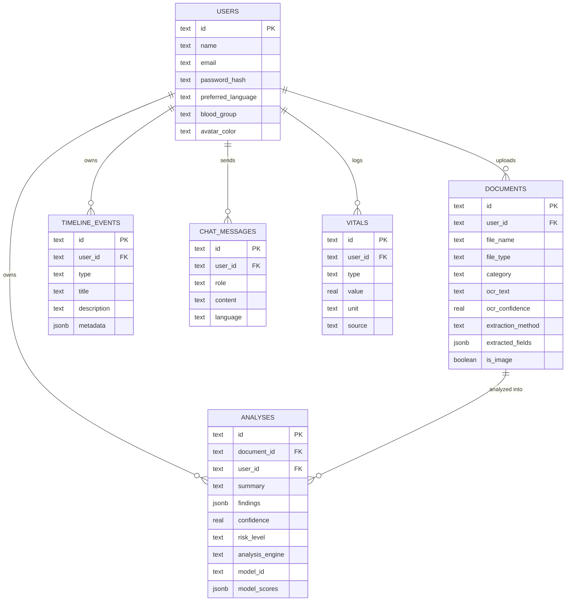

# MEDISCOPE AI — Architecture

Also viewable live at `/architecture` inside the running app.

## 1. High-level system diagram (as running in this sandbox)



## 2. Data model



## 3. Document → insight data flow

```
Authenticated drag & drop PDF/PNG/JPG (15MB maximum; file signature checked)
        │
        ▼
POST /api/documents ── saves file outside public/ under data/uploads/{userId}/…
        │
        ▼
Selectable PDF text: pdf-parse │ scanned PDF/image: local Tesseract OCR
        │
        ▼
Real extracted text, measured OCR confidence, and source excerpts persisted transactionally
        │
        ▼
Owner-checked file route, documents explorer, source-labelled copilot, and report endpoint
        │
        ▼
(Images only) user selects model → authenticated POST /api/analyses proxies private bytes to loopback service
        │
        ▼
Selected H5 returns class scores; result and provenance persist under the owning account
```

## 4. Target production architecture (as originally specified)

| Layer | Specified technology |
|---|---|
| Frontend | React 18 + Vite, TypeScript, Tailwind CSS, Framer Motion, Three.js |
| Backend | Python FastAPI, Pydantic schemas, async workers (Celery + Redis) for OCR/vision jobs |
| AI services | Local Tesseract OCR; supplied experimental image classifiers; future clinical validation and optional hosted LLM/RAG |
| Database | MongoDB Atlas — `users`, `documents`, `analyses`, `timeline_events`, `chat_messages`, `vitals` collections |
| Infra | Docker, CI/CD, S3-compatible object storage for scans, HIPAA/DPDP-aligned access controls |

## 5. Why the sandbox substitution is safe

Both stacks expose the same contract:

- Stateless REST endpoints keyed by an authenticated `userId`
- A relational/document store with the same six entities (`users`, `documents`, `analyses`,
  `timeline_events`, `chat_messages`, `vitals`)
- Server-side session auth (JWT) with hashed passwords
- A private Next-to-Flask inference contract. The Flask service loads one allowlisted Keras model at
    a time; model IDs, class maps and preprocessing are declared in `ai_service/model.registry.json`.

This lets the local prototype run supplied classifiers without exposing model files or service
credentials to the browser. Production still requires clinical model validation, managed secrets,
scalable inference hosting and clinical governance.

## 6. Limitations disclosed

- PDF text extraction and Tesseract OCR are real transcription, but OCR may be inaccurate and is not
    a clinical interpretation. Tesseract language data is downloaded on first use and cached locally.
- Seven user-supplied image H5 files load one at a time through Keras 3/PyTorch. Their outputs are
    experimental scores only, not clinical probabilities or diagnoses. Skin is disabled because its
    seven outputs do not match the supplied two-label map. No tabular heart model is included.
- There is no hosted LLM. The multilingual health guide is rule-based, uses account-scoped sources,
    and does not translate the original transcription.
- Files are stored outside `public/` and served through owner checks, but local disk is not encrypted
    at rest and is not a production object store.
- Report PDFs include account data/source transcription only, are generated on demand, and are not
    signed or clinically validated.
- Nothing in this application is a certified medical device or a substitute for professional care.
